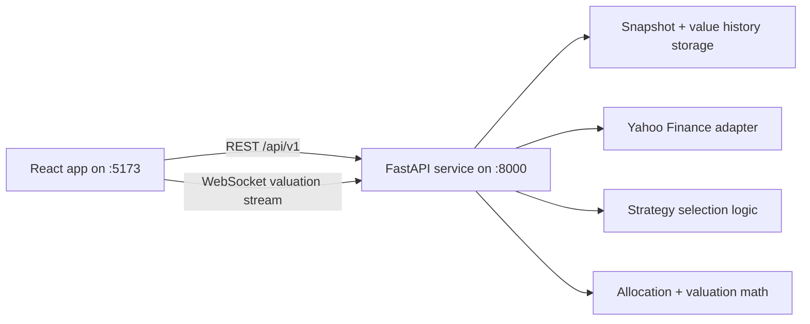

# Stock Portfolio Suggestion Engine

A portfolio recommendation and monitoring application built with **Python**, **FastAPI**, **React**, and **TypeScript**. The app lets a user choose one or two investment strategies, builds a whole-share portfolio from mapped stocks/ETFs, and tracks live portfolio valuation, allocation, historical equity trends, and basic risk metrics.

## Project summary

The system is designed around two services:

- A **FastAPI backend** that handles portfolio construction, market data access, persistence, valuation, and risk calculations.
- A **React frontend** that renders the interactive dashboard and consumes the backend through REST and WebSocket endpoints.

This architecture supports live valuation updates and keeps market-data logic out of the browser.

## Supported investment strategies

The app supports the following strategies:

- Ethical Investing
- Growth Investing
- Index Investing
- Quality Investing
- Value Investing

Each strategy maps to a curated set of stocks and/or ETFs, with at least three candidates per strategy. The engine can build a portfolio from one strategy or blend two strategies together.

## Key features

- Minimum investment amount of **$5,000**
- One- or two-strategy portfolio construction
- Whole-share allocation with visible leftover cash
- Live or fallback market pricing through Yahoo Finance
- Saved named portfolios with activation, rename, duplicate, and delete actions
- Equity-history chart with trading-day semantics
- Recorded 5-day equity history for saved portfolios
- Per-window Sharpe ratio, risk/return scatter, and correlation matrix
- Corporate-action handling for stock splits when reloading saved portfolios

## Architecture



## Repository layout

```text
api/
  market_data.py               # Market data adapter and risk-free rate lookup
  portfolio.py                 # Pure allocation, valuation, history, and Sharpe math
  storage.py                   # Snapshot + recorded value history persistence
  strategies.py                # Strategy universes, scoring, and constraints
  service/
    main.py                    # FastAPI app factory
    orchestrator.py            # Backend service layer
    routes/                    # REST + WebSocket routes
    schemas.py                 # API request/response models
  tests/                       # Backend test suite

web/
  src/components/              # Dashboard UI
  src/hooks/                   # Data-fetching and routing hooks
  src/utils/                   # Formatting and helper utilities

scripts/
  bootstrap.sh                 # One-line local setup

data/                          # Runtime portfolio snapshots and value history
```

## Installation

### One-line setup

From the repository root:

```bash
./scripts/bootstrap.sh
```

### Manual setup

```bash
python3 -m venv .venv
./.venv/bin/pip install --upgrade pip
./.venv/bin/pip install -r api/requirements.txt
cd web && npm install
```

## Running locally

### Start both services

```bash
make dev
```

Then open:

- Frontend: [http://localhost:5173](http://localhost:5173)
- API: [http://127.0.0.1:8000](http://127.0.0.1:8000)

### Backend only

```bash
make dev-api
```

### Frontend only

```bash
make dev-web
```

## Docker

```bash
docker compose up --build
```

## Testing

```bash
make test
make test-api
make test-web
```

## Portfolio construction approach

The portfolio engine follows this general flow:

1. The user enters an investment amount and chooses one or two strategies.
2. The backend scores candidate securities inside each selected strategy.
3. If two strategies are selected, the engine blends them using normalized strategy weights.
4. Sector concentration and ETF diversification constraints are applied.
5. The engine converts weights into whole-share purchases using current market prices.
6. Leftover cash is preserved and shown separately.

## Valuation and history semantics

- **Equity Value** means the value of invested holdings only.
- **Total Portfolio Value** means equity value plus leftover cash.
- The **5D chart** uses **trading days**, not calendar days.
- Saved portfolios record one equity value per effective trading day in `data/value_history/`.
- Fresh portfolios can still show a short-window backcast until enough recorded days exist.

## Math at a glance

| Quantity | Formula |
| --- | --- |
| Allocated dollars | `investment_amount * target_weight` |
| Whole-share quantity | `floor(allocated_dollars / current_price)` |
| Actual cost | `shares * initial_price_unadjusted` |
| Equity value | `shares * current_price` |
| Total portfolio value | `equity_value + leftover_cash` |
| Daily returns | `pct_change(close_series)` |
| Annualized return | `mean(daily_returns) * 252` |
| Annualized volatility | `std(daily_returns) * sqrt(252)` |
| Sharpe ratio | `(annualized_return - risk_free_rate) / annualized_volatility` |

## Risk analytics

The dashboard includes:

- Sharpe ratio by independent window (`3M`, `6M`, `1Y`, `2Y`)
- Risk/return scatter for the selected equity-history range
- Correlation matrix for funded holdings

Short windows can suppress scatter/correlation output when there are not enough daily samples for a stable estimate.

## Configuration

Environment variables used by the backend:

| Variable | Default | Meaning |
| --- | --- | --- |
| `PORTFOLIO_POLL_SECONDS` | `5` | Quote polling cadence for live updates |
| `PORTFOLIO_CORS_ORIGINS` | `http://localhost:5173,http://127.0.0.1:5173` | Allowed frontend origins |

## Notes and limitations

- Yahoo Finance is used as the market data source, so “live” values are near-real-time polling results rather than an exchange-native stream.
- Whole-share allocation can leave residual cash.
- Recorded 5-day history is available for saved portfolios after the app has observed them across trading days.
- Risk metrics are educational analytics, not investment advice.

## Submission note

This repository contains the application code, tests, and local setup scripts needed to run and evaluate the project. Runtime data and local build artifacts are intentionally excluded from version control.
